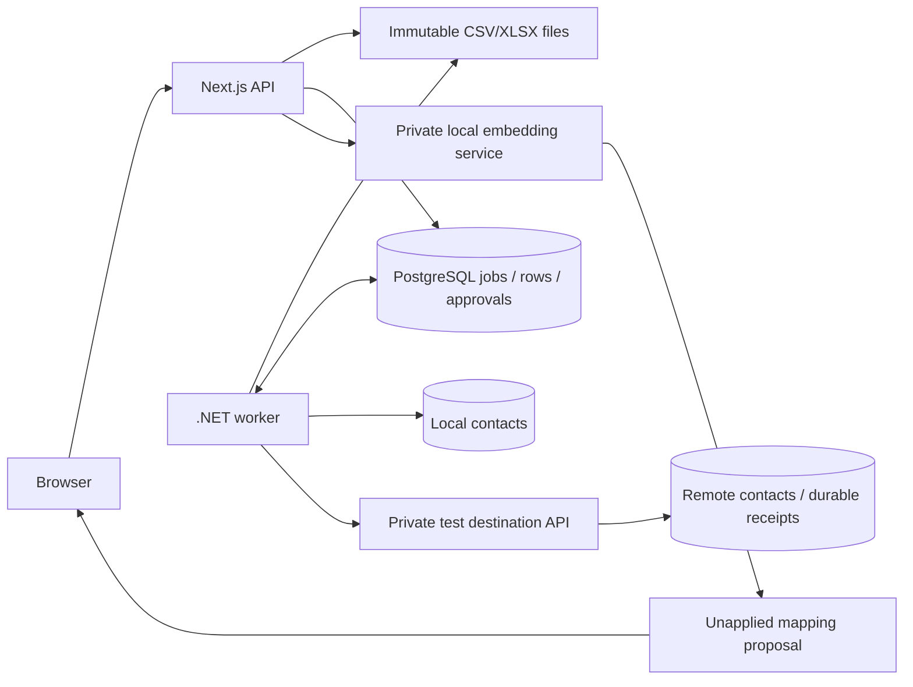

# Relay architecture
The request API handles identity, uploads, review, control and downloads. The .NET worker owns parsing, normalization, validation and batch effects. PostgreSQL stores the job state and row ledger. Immutable original bytes live in a separate durable upload directory.

## State and versioning
Normal flow: parsing → mapping → validating → review → queued → running → completed. Mapping, bounded transformations and corrections increment mapping_version and clear approval. Queued/running can pause and resume. Cancellation is terminal; receipt-only reconciliation can still account for a previously authorized external request. Five failures stop processing; reviewer retry restores the saved phase without resetting checkpoints.

New approvals fingerprint file_hash, mapping_version, schema_version, immutable schema_hash and destination. Transform changes increment the mapping version. Legacy jobs keep approval format 1 for compatibility. This hash is a version binding, not an authentication signature: reviewer permission is checked separately.

## Local atomicity
Contacts use unique (org_id,email). A commit transaction locks the job, inserts only missing contacts, classifies existing/conflicting contacts, records row outcomes and advances the checkpoint. INSERT RETURNING identifies newly inserted rows. Provenance equality is not used to infer a new insert. Existing data is never overwritten.

Both injected crash windows are verified: exit 74 before transaction commit rolls back effects; exit 73 after checkpoint 50,000 leaves the committed prefix intact. Repeated workers start from the durable checkpoint. Completed row outcomes partition all staged input rows.

## External uncertainty
Before sending, the worker commits an outbox entry with a stable job/version/row key. It marks the attempt uncertain before network I/O, then calls the private API without holding a database transaction. The session advisory locks remain held for one bounded batch. Destination receipts and effects commit together in the external service's separate transaction.

Receipt lookup runs before resending. Confirmed receipts update the local ledger transactionally; missing receipts are resubmitted with the same key only while the job is active. Pause/cancel prevents authorization of new sends; already authorized in-flight sends may complete. Inactive jobs perform bounded receipt-only reconciliation. Unresolved outcomes remain visible instead of being reported as failures or successes without evidence.

The test destination's unique (tenant,key) receipt and unique (tenant,email) contact constraints, payload hash checking, and strongly consistent lookup are explicit prerequisites. They do not imply that an arbitrary external API supports exactly-once effects.

## Fair scheduling and bounds
The query selects the oldest eligible job per tenant, filtered by supported schema version. Tenant and job advisory locks admit at most one batch per tenant across workers. Parsing, validation and delivery each return to the scheduler after a batch. An idle tenant's small file can progress while another tenant parses a large file.

Up to eight active source cursors cache readers. Their durable position is a logical record count; after a crash or another worker advancing that job, a reader reopens and skips the already staged prefix. This bounds memory and avoids reopening every batch, at the cost of rescanning after interruption. Workbook validation and the initial checksum still scan the source when opening a cursor; fairness is bounded scheduling, not a strict latency SLA.

Uploads cap at 32 MB. CSV parsing caps at 200k rows, 100 columns and 16k characters per cell. XLSX accepts one sheet, rejects formulas, caps expanded entries at 256 MB and shared-string/style parts at 16 MB. The XLSX library may buffer shared strings; the worker does not materialize a DataSet.

## Trust boundaries
Membership precedes every tenant lookup. Operators cannot approve, retry failed jobs, view operational diagnostics or invite members. Composite foreign keys protect provenance. No PostgreSQL RLS policy is claimed; API authorization plus structural constraints implement isolation.

Only configured private service URLs are used. The AI receives headers, produces structured proposals, and cannot mutate mappings or approve imports. Its pinned model and conservative score/margin policy are evaluated separately from the alias baseline. Source rows never go to a hosted model.

Original bytes are hashed before job creation and checked when opening the parser. File creation plus database insertion is not a distributed transaction; a process loss can leave an unreferenced original. Do not delete files referenced by any retained job. Live reports reflect an operational view; completed jobs provide stable final outcomes.

## Operations
Worker heartbeat, supported schemas, RSS, batch timing, checkpoints and trace identifiers feed reviewer diagnostics. Active-batch throughput excludes queue wait/backoff. Activity context is propagated to the test destination. These are local persisted traces/metrics; no managed observability backend is claimed.

Backup exports one PostgreSQL snapshot shared with pg_dump, then copies and hashes immutable originals. Restore verification uses a distinct temporary database and compares counts plus completed-job invariants. Single-host deployment uses durable shared volumes; cross-host object storage remains outside this implementation.
